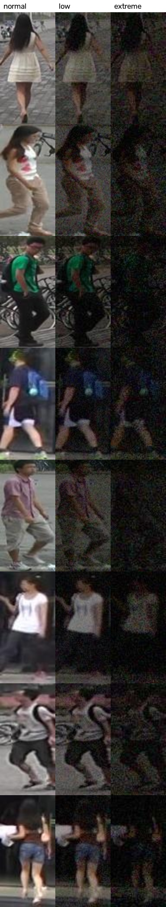
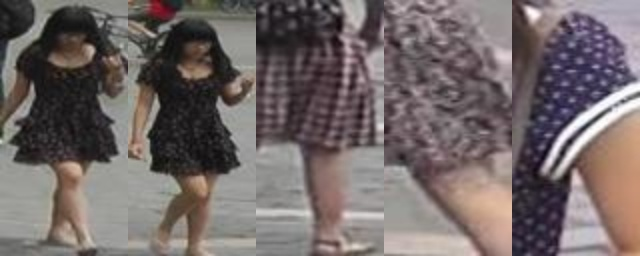

# VAST-ReID
**A Low-Light Benchmark Dataset for Person Re-Identification with Visual and Attribute-Rich Semantic Tracking**

## Overview
VAST-ReID는 야간·저조도 환경에서 사람 재식별(Person Re-ID) 성능을 평가하기 위한 벤치마크 데이터셋과 평가 파이프라인입니다.
기존 ReID 데이터셋은 대부분 밝은 환경에서 촬영되어 실제 야간 CCTV 상황을 반영하지 못합니다.
이 프로젝트는 공개 데이터셋(Market-1501)에 물리 기반 저조도를 합성해 **조도 3단계 데이터셋**을 만들고,
**저조도에서 ReID가 왜 무너지는지 분석**하고, 학습 없는 보정(AdaBN·CSLS·재순위화)과 **저조도 미세조정**으로 성능을 회복하는 방법을 검증합니다.



## 핵심 결과 (요약)
> 모든 수치는 실제 실행 결과이며 `results/*.csv`에 있습니다. OSNet(Market-1501 사전학습) 추론에서 시작해, 학습 없는 보정 → 저조도 미세조정 → MSMT17 추가 학습 순으로 개선했습니다.
> 아래 표는 Low 쿼리 → 주간 gallery 기준이며, 극저조도(Extreme) 진행은 바로 아래 표에 있습니다.

| 조건 | Rank-1 | mAP |
|---|---|---|
| 밝은 query → 밝은 gallery (Normal) | 94.5 | 82.6 |
| 어두운 query → 어두운 gallery (Low) | 48.5 | 22.4 |
| **어두운 query → 밝은 gallery (야간 CCTV → 주간 기록)** | **23.0** | **18.7** |
| + 저조도 개선 전처리 (Zero-DCE 등) | 개선 없음 | 개선 없음 |
| + 속성 재순위화 (목격자 진술 + 예측 속성) | 34.3 | 28.3 |
| + hubness 완화 (CSLS) | 46.1 | 35.5 |
| + CSLS + 속성 재순위화 | 54.9 | 42.2 |
| + AdaBN (저조도 이미지로 BN 통계만 재추정) | 85.3 | 71.0 |
| + AdaBN + CSLS + 속성 재순위화 | 86.8 | 73.3 |
| + AdaBN + k-reciprocal + CSLS + 속성 | 90.3 | 88.2 |
| + 저조도 미세조정 (train 3조도, 12 에폭) | 88.8 | 70.5 |
| + 미세조정 + k-reciprocal + CSLS + 속성 | 92.8 | 89.1 |
| **최종: Market + MSMT17 미세조정(24 에폭) + k-reciprocal + CSLS + 속성** | **90.8** | **85.6** |

**극저조도(Extreme) 쿼리 → 주간 gallery, Rank-1 / mAP**

| 단계 | Rank-1 | mAP |
|---|---|---|
| 사전학습 OSNet | 0.0 | 0.2 |
| + AdaBN + CSLS + 목격자 속성 | 35.6 | 28.8 |
| 저조도 미세조정 (Market, 12 에폭) | 65.4 | 47.1 |
| 미세조정 + k-reciprocal + CSLS + 속성 | 78.9 | 76.8 |
| **최종 (Market + MSMT17, 24 에폭) + k-reciprocal + CSLS + 속성** | **83.0** | **77.9** |

### 정확도를 올린 방법 (순서대로)
1. **원인 분석**: 어두운 사진의 노이즈를 옷 무늬로 착각해 검색 결과가 몇몇 사진(hub)으로 몰림.
2. **학습 없는 보정**: AdaBN(내부 정규화 통계를 어두운 사진에 맞춤), CSLS(hub 감점), 목격자 속성, k-reciprocal 재순위화 → Low 23.0 → 90.3.
3. **저조도 미세조정**: 모델이 어두운 train 사진을 직접 보며 12 에폭 추가 학습(약 7분) → Extreme 35.6 → 65.4, 조합 포함 78.9.
4. **데모 속성 가중치 오류 수정**: 검증으로 고른 λ 사용, 입력한 속성 수에 비례 → 틀린 진술에 21.5까지 무너지던 문제 해결.
5. **온라인 저조도 합성**: 같은 어두운 사진을 반복해서 보지 않도록 매번 새로 합성 → 처음 보는 노이즈 43.1 → 49.9.
6. **MSMT17 추가 학습**: 다른 장소·카메라 사진으로 학습 → 처음 보는 색 조명 36.9 → 56.8, MSMT17 극저조도 5.8 → 30.1.
7. **추가 학습(12 → 24 에폭)**: 모든 시험에서 소폭 개선 → Extreme 조합 83.0.

- 어두워지면 Rank-1이 94.5 → 48.5로 거의 절반이 됩니다.
- 사진을 밝게 만드는 전처리는 노이즈까지 증폭시켜 오히려 성능을 떨어뜨렸습니다.
- 원인을 분석해 보니, 노이즈를 옷의 잔무늬로 착각해 **서로 다른 사람의 어두운 query가 같은 몇몇 gallery 이미지로 몰리고**(hubness) 있었습니다.
- 검색 단계에서 hub를 깎는 CSLS와 속성 정보를 더하면 야간→주간 Rank-1이 **23.0 → 54.9**로 회복됩니다.
- 원인 자체(모델 내부 정규화 통계가 밝은 사진에 맞춰져 있음)를 고치는 **AdaBN**을 적용하면 **85.3**, CSLS·속성까지 합치면 **86.8**,
  여기에 ReID 표준 재순위화인 **k-reciprocal**을 더하면 **90.3 / mAP 88.2**까지 회복됩니다. 극저조도→주간도 0.0 → 35.6이 됩니다. (합성 저조도라 AdaBN 효과가 과대평가됐을 수 있음, [한계](#한계) 참고)
- 학습 없이는 극저조도가 35.6에서 멈춰, train 이미지만으로 **저조도 미세조정**을 했습니다. 극저조도→주간 Rank-1이 **0.0 → 78.9 (mAP 76.8)**,
  야간→주간이 **92.8**이 됩니다. 대신 밝은 사진끼리는 94.5 → 91.3(재순위화 포함 95.5 → 93.5)으로 조금 내려갑니다. 자세한 내용은 [저조도 미세조정](#저조도-미세조정-resultsfinetunecsv-resultskreciprocal_ftcsv).
- 표의 "어두운 → 밝은" 아래 행들은 재순위화를 위해 코사인 유사도 기준입니다. 유클리드 거리 기준 베이스라인은 25.5 / 20.3입니다.
- **최종 모델**은 MSMT17(다른 장소·카메라 15대) 사진을 함께, 매번 새로 합성한 저조도로 학습했습니다. Market 점수는 조금 낮지만 **처음 보는 색 조명에서 36.9 → 56.8**, 극저조도 조합 **83.0**으로 가장 강합니다. [최종 모델](#최종-모델-일반화-시험) 참고.

---

## 원래 계획과 바뀐 점

| | 원래 계획 | 현재 |
|---|---|---|
| 데이터 | 실촬영 + 합성 | **공개 데이터셋(Market-1501, 학습 보강·검증용 MSMT17) + 저조도 합성** (실촬영 생략) |
| 실행 환경 | Google Colab | 로컬 PC (WSL2 Ubuntu, RTX 5080, PyTorch cu128) |
| 모델 | 일부 직접 학습 | 사전학습 모델 추론 + 속성용 선형 분류기 → **OSNet 저조도 미세조정**(최종: Market + MSMT17, 온라인 합성, 24 에폭, 약 51분) |
| 속성 라벨 | VLM 라벨링 + 사람 검수 | 공개 속성 라벨(Market-1501 Attribute)에서 6개 선택 |
| 개선 방법 | 저조도 개선(Zero-DCE) 중심 | Zero-DCE는 실패 확인 → **AdaBN + hubness 완화(CSLS) + 속성 재순위화 + k-reciprocal**, 이후 미세조정 |
| AI API | 라벨링 도구 | 호출 수가 적은 곳에만 사용 (아래 참고) |
| 트래킹 | YOLO + ByteTrack 데모 | MOT17 3개 시퀀스에 같은 저조도 합성 → ByteTrack vs BoT-SORT+OSNet(+AdaBN) 정량 평가 |

---

## 시스템 구조

```
Market-1501 원본 사진
   │ ① 저조도 합성 (빛 감소 + 센서 노이즈)            tools/synthesize_lowlight.py
   ▼
normal / low / extreme 3단계 데이터셋                    data/vast/{level}/{train,query,gallery}
   │
   ├─② OSNet (사전학습) → 외형 특징 벡터              vastreid/reid.py, tools/evaluate.py
   │     └ 저조도 이미지는 AdaBN 모델 사용 (BN 통계만 저조도로 재추정)   tools/adabn.py
   │
   ├─③ CLIP (사전학습) → 이미지 특징 → 선형 분류기 → 속성 확률
   │                                                     vastreid/clip_attr.py, tools/attr_probe.py
   │
   └─④ 최종 점수 = 외형 유사도 − β·(hub 점수) + λ·(속성 일치도)
                                                         tools/rerank.py, tools/hubness.py
                     │
                     ▼
        Rank-1 / mAP / mINP → results/*.csv → Gradio 데모 (demo/app.py)
```

### 각 단계의 원리

**① 저조도 합성**: 사진을 단순히 어둡게 편집하지 않고, 카메라가 어두운 곳에서 찍을 때처럼 만듭니다.
선형(빛의 양) 공간에서 노출을 줄이고(Low ×0.15~0.30, Extreme ×0.03~0.08), 빛이 적을 때 생기는 센서 노이즈(Poisson + Gaussian),
약한 블러, 색 틀어짐, JPEG 압축을 더합니다. 난수 시드가 고정되어 있어 몇 번을 실행해도 같은 결과가 나옵니다.

**② 외형 특징 (OSNet)**: 사람 사진 한 장을 512개의 숫자(벡터)로 바꾸는 모델입니다. 같은 사람이면 벡터가 비슷하게 나오도록 이미 학습되어 있습니다.
검색은 query 벡터와 가장 가까운 gallery 벡터를 순서대로 찾는 일입니다.

**②-1 AdaBN**: OSNet 내부의 정규화 층(BatchNorm)은 학습 때 본 밝은 사진의 평균·분산으로 특징을 정규화합니다.
어두운 사진이 들어오면 이 통계가 맞지 않아 특징이 한쪽으로 쏠리고, 그 결과 hubness가 생깁니다.
AdaBN은 **라벨 없는 저조도 train 이미지를 모델에 통과시켜 정규화 통계만 다시 계산**합니다. 가중치는 전혀 바꾸지 않고 몇 초면 끝납니다.
검증: normal 이미지로 다시 계산하면 원래 성능(94.2 vs 94.5)이 유지되고, 저조도용 통계를 밝은 query에 쓰면 41.5로 떨어집니다. 즉 조도에 맞춘 효과입니다.

**③ 속성 예측 (CLIP + 선형 분류기)**: CLIP은 이미지와 문장을 같은 공간의 벡터로 바꿉니다.
"흰 셔츠를 입은 사람"이라는 문장과 이미지가 가까우면 흰 셔츠일 가능성이 높다고 봅니다(zero-shot).
정확도를 높이려고 CLIP 특징 위에 속성마다 로지스틱 회귀(선형 분류기)를 하나씩 붙였습니다. CLIP 자체는 학습하지 않습니다.
속성 6개: 상의 색, 하의 색, 소매, 하의 종류, 가방, 모자 (**성별·나이·머리 길이는 제외**).

**④ 점수 조합**
- **외형 유사도**: OSNet이 본 생김새
- **속성 일치도**: 상의 색, 가방 등이 얼마나 같은가. 어두워져도 색과 형태는 일부 남아 외형 정보를 보완합니다.
- **hub 점수 (CSLS)**: 그 gallery 사진이 어두운 사진들 전반과 두루 비슷한가. 두루 비슷하면 특정 사람이 아니라 노이즈에 반응한 것이므로 점수를 깎습니다.
- **λ, β 선택**: 테스트셋은 보지 않고 train 이미지로 만든 검증 분할에서만 고릅니다.

### 저조도에서 ReID가 무너지는 이유: hubness
어두운 query 3,368장의 검색 결과(top-10)를 분석했습니다 (`docs/DEVLOG.md`).

| query 조도 | top-10에 나온 서로 다른 gallery 이미지 | 자주 나온 상위 20장의 점유율 |
|---|---|---|
| Normal | 12,100 | 0.6% |
| Low | 6,564 | 22.2% |
| Extreme | 176 | 96.1% |

Low에서는 이미지 한 장이 query 938개의 top-10에 등장했습니다. 이런 hub 이미지는 대부분 땡땡이·체크·꽃무늬처럼
**잔무늬가 촘촘한 옷**이었습니다. 모델이 센서 노이즈를 옷의 무늬로 착각한 것입니다.
Low→Normal에서 상위 20장 점유율은 CSLS 적용 시 22.2% → 3.3%, AdaBN 적용 시 0.6%(밝은 사진 수준)로 줄어듭니다.



---

## AI API 활용 (Grok, GPT)

수업에서 지원받은 AI API는 반 전체가 함께 쓰는 키이므로, **호출 수가 적은 곳에만** 사용했습니다.

| 용도 | 하는 일 | 호출량 |
|---|---|---|
| 비전 LLM 저조도 실험 | 사진을 보여주고 6개 속성을 JSON으로 답하게 해 조도별 정확도를 비교 | 50명 × 3조도 × 2모델 = 300회 |
| 데모 텍스트 검색 (선택, 로컬 전용) | "흰 반팔에 백팩 멘 사람" → 속성 JSON | 검색 1번에 1회 |
| 데모 시맨틱 캡션 (로컬 전용) | 텍스트 검색에서 고른 인물 사진 → 옷차림·소지품을 자연어 1~2문장으로 | 인물 선택 1번에 1회 |
| 데모 오답 설명 (로컬 전용) | 쿼리와 잘못 나온 사진을 함께 보여주고 왜 헷갈렸는지 설명 (계산된 실패 원인을 힌트로 제공) | 오답 카드 클릭 1번에 1회 |

캡션·설명은 옷차림·색·소지품·조명만 말하도록 지시하고 성별·나이·인종 등은 언급하지 않게 했습니다. 같은 사진은 캐시에서 재사용하고, 서버 실행당 최대 120회로 제한합니다.

**ReID 검색 자체를 API로 하지 않은 이유**: query 3,368장을 gallery 15,913장과 모두 비교하면 수천만 번 호출이 필요해
비현실적이고, 표준 지표(Rank-1, mAP)로 비교할 수도 없습니다. 대량 계산은 로컬 모델이, 사람의 말을 이해하는 일과
소규모 비교 실험은 API가 맡도록 나눴습니다.

**토큰 절약 장치** (`vastreid/llm.py`): 같은 요청은 캐시에서 재사용, 실행당 호출 상한, 호출 없이 횟수만 세는 dry-run,
사용량 로그(`outputs/api_usage.csv`). API 키는 로컬 `.env`에만 두며 레포와 공개 데모에는 포함하지 않습니다.

### 비전 LLM도 어두운 사진은 못 알아본다
속성 평균 정확도(%), 테스트 50명 × 3조도 (`results/attr_acc_vlm.csv`). "모르겠다(unknown)" 답변은 오답 처리.

| 모델 | Normal | Low | Extreme |
|---|---|---|---|
| Grok (`grok-4.20-0309-non-reasoning`) | **85.6** | 75.7 | 36.7 |
| GPT (`gpt-4.1-mini`) | 83.2 | 69.9 | 32.5 |
| CLIP + 선형 분류기 | 78.5 | **78.6** | **63.8** |
| CLIP + 미세조정 OSNet + 선형 분류기 | 83.4* | 82.3* | 78.3* |
| CLIP zero-shot | 52.4 | 44.5 | 21.2 |

\* 이 행만 50명 샘플이 아닌 query·gallery 전체 기준입니다(`results/attr_acc_probe-clip+osnet-ft.csv`). 미세조정 OSNet 특징을 더하면 극저조도 속성 예측이 크게 좋아집니다.

밝을 때는 비전 LLM이 가장 정확하지만, 극저조도에서는 크게 무너집니다. 선형 분류기는 흔한 값(예: 모자 안 씀)을 잘 맞히는
효과도 포함되어 있어 해석에 주의가 필요합니다. 표본이 작아 오차 범위가 큽니다.

---

## 상세 결과

### 저조도 개선 전처리 — 효과 없음 (`results/enhance.csv`, `results/enhance_v2.csv`)
Rank-1 (%), 같은 조도끼리 검색. 게이팅 = 어두운 이미지(평균 밝기 < 0.25)에만 적용.

| 방법 | Normal | Low | Extreme |
|---|---|---|---|
| 없음 | **94.5** | **48.5** | 2.5 |
| 감마 (전부 적용) | 90.1 | 43.1 | 2.9 |
| CLAHE (전부 적용) | 85.8 | 42.8 | 3.5 |
| Zero-DCE (전부 적용) | 62.2 | 32.4 | 2.5 |
| Zero-DCE (게이팅) | 91.8 | 31.5 | 2.5 |
| 노이즈 제거 + Zero-DCE (게이팅) | 91.4 | 27.1 | 2.9 |

밝기를 올리면 센서 노이즈도 함께 증폭됩니다 (`docs/figures/enhance_grid.jpg`).

### 개선 방법 조합 (`results/hubness_wide.csv`, `results/hubness_adabn.csv`)
Rank-1 / mAP (%), 코사인 유사도 기준. k, β, λ는 train 검증 분할에서 선택.

| 방법 | Low → Low | Low → Normal | Extreme → Extreme | Extreme → Normal |
|---|---|---|---|---|
| 외형만 | 48.1 / 22.6 | 23.0 / 18.7 | 2.4 / 1.0 | 0.0 / 0.2 |
| + 예측 속성 | 48.8 / 23.9 | 31.6 / 25.4 | 2.6 / 1.1 | 0.2 / 0.6 |
| + 목격자 속성 | 49.7 / 25.2 | 34.3 / 28.3 | 3.0 / 1.2 | 7.2 / 5.7 |
| + CSLS | 50.7 / 25.5 | 46.1 / 35.5 | 3.0 / 1.1 | 0.5 / 0.7 |
| + CSLS + 목격자 속성 | 53.7 / 28.4 | 54.9 / 42.2 | 3.5 / 1.5 | 8.9 / 6.4 |
| AdaBN | 80.7 / 60.0 | 85.3 / 71.0 | 17.2 / 7.8 | 25.4 / 19.8 |
| AdaBN + CSLS | 80.9 / 59.9 | 85.1 / 70.5 | 18.9 / 8.3 | 28.5 / 22.9 |
| AdaBN + CSLS + 목격자 속성 | 81.5 / 61.1 | 86.8 / 73.3 | **19.7** / 8.7 | **35.6** / 28.8 |
| AdaBN + k-reciprocal | 86.2 / 78.4 | 89.8 / 87.8 | 18.9 / 10.3 | 30.2 / 32.5 |
| **AdaBN + k-reciprocal + CSLS + 목격자 속성** | **86.0 / 78.4** | **90.3 / 88.2** | 19.4 / **10.7** | 34.4 / **37.3** |

- 예측 속성: query·gallery 모두 CLIP + 선형 분류기 예측 (완전 자동)
- 목격자 속성: query는 사람이 진술한 인상착의(정답 속성으로 대체), gallery는 예측. 목격자 진술 + CCTV 기록 검색 시나리오
- 참고 상한선(정답 속성을 양쪽에 사용): Low→Normal 61.0 / 58.4 (`results/rerank_oracle.csv`)
- AdaBN 단독(유클리드 거리 기준, `results/adabn.csv`): Low→Normal 25.5 → 85.4, Extreme→Normal 0.0 → 25.9
- k-reciprocal(`results/kreciprocal.csv`)은 논문 표준값(k1=20, k2=6, λ=0.3)으로 고정하고, 원래 코사인 거리에 먼저 적용한 뒤 CSLS·속성을 더합니다.
  **AdaBN 없이 쓰면 오히려 손해**입니다(Low→Normal 23.0 → 19.9): 어두운 쿼리의 이웃이 이미 hub로 오염되어 있어 잘못된 이웃을 강화하기 때문입니다.

### 트래킹: 저조도 MOT17 (`results/tracking.csv`)
MOT17 train 시퀀스 3개(02, 04, 09, 총 2,175프레임)에 같은 저조도 합성을 적용하고, YOLO11m 검출 결과를 모든 트래커가 공유합니다.
BoT-SORT의 외형 특징은 우리 OSNet(Market-1501 사전학습)으로 직접 계산했습니다. 평가는 TrackEval.

| 조도 | 트래커 | HOTA | DetA | AssA | IDF1 | ID 전환 |
|---|---|---|---|---|---|---|
| Normal | ByteTrack | **45.9** | 40.4 | 52.5 | **55.4** | 96 |
| Normal | BoT-SORT + OSNet | 45.0 | 38.3 | 53.0 | 54.5 | 90 |
| Low | ByteTrack | 43.7 | 38.0 | 50.4 | 53.0 | 94 |
| Low | BoT-SORT + OSNet | 43.8 | 36.2 | 53.2 | 52.7 | 89 |
| Low | BoT-SORT + OSNet (AdaBN) | 43.8 | 36.2 | 53.2 | 52.7 | 89 |
| Extreme | ByteTrack | 15.5 | 7.7 | 31.2 | 12.1 | 43 |
| Extreme | BoT-SORT + OSNet | 16.5 | 7.2 | 37.9 | 12.5 | 40 |
| Extreme | **BoT-SORT + OSNet (AdaBN)** | **17.0** | 7.2 | **40.3** | **13.0** | **34** |

- **Low에서는 트래킹이 거의 떨어지지 않습니다** (HOTA 45.9 → 43.7). ReID(94.5 → 48.5)와 대조적인데, 트래킹은 주로 위치·움직임으로 연결하고 YOLO 검출은 Low에서 버티기 때문입니다.
- **Extreme에서는 검출이 무너집니다** (DetA 40.4 → 7.7). 트래킹 성능의 병목은 트래커가 아니라 검출입니다.
- 남은 검출을 연결하는 능력(AssA)은 외형 특징이 도움이 됩니다: ByteTrack 31.2 → BoT-SORT+OSNet 37.9 → **AdaBN 40.3**, ID 전환 43 → 34.
- Normal에서 AdaBN 모델은 원래 모델과 같으므로 표에서 생략했습니다.
- **YOLO에도 AdaBN을 적용하면 오히려 나빠졌습니다** (`results/tracking_yolo_adabn.csv`, Extreme HOTA 17.0 → 13.0, Low 43.8 → 33.8).
  적응용으로 쓴 MOT17-11(실내)과 평가 시퀀스(야외)의 장면이 달라 BN 통계에 장면 차이까지 섞였기 때문입니다.
  ReID에서 AdaBN이 효과가 컸던 것은 Market의 train과 test가 같은 장소·같은 카메라였기 때문입니다.


미세조정 OSNet으로 BoT-SORT를 다시 돌려도 결과는 거의 같았습니다(`results/tracking_ft.csv`, Extreme HOTA 16.5 / IDF1 12.7, AdaBN 17.0 / 13.0).
극저조도 트래킹의 병목은 외형 특징이 아니라 **검출**이기 때문입니다(YOLO가 사람을 찾지 못하면 ReID가 연결할 대상이 없음).
---

### 최종 모델: 일반화 시험
미세조정이 같은 합성 노이즈를 외웠을 수 있다는 걱정과, 다른 장소에서도 되는지를 확인하려고 두 가지를 바꾸고 시험을 넓혔습니다.

- **온라인 저조도 합성** (`tools/finetune.py --online`): 미리 만든 저조도 1장을 반복하지 않고 매번 노출·노이즈·색을 새로 뽑아 합성.
- **MSMT17 추가** (`--msmt`): 다른 대학 캠퍼스, 카메라 15대, 아침·낮·오후 사진 1,041명(32,621장). 학습 25분.
- 시험: ① Market(같은 합성) ② 처음 보는 저조도(`tools/eval_shift.py`: 노이즈 2배·JPEG 저화질 / 주황 가로등 색) ③ MSMT17 test 저조도(`tools/eval_msmt.py`)

Rank-1 (gallery는 모두 주간)

| 모델 | Market Low | Market Extreme | 처음 보는 노이즈 | 처음 보는 색 조명 | MSMT17 Extreme |
|---|---|---|---|---|---|
| 사전학습 | 23.0 | 0.0 | 0.0 | 1.8 | 0.2 |
| 미세조정 (Market, 고정 합성) | **88.8** | 65.4 | 43.1 | 33.7 | 5.6 |
| 미세조정 (Market, 온라인 합성) | 88.0 | 67.1 | 49.9 | 36.9 | 5.8 |
| 최종 (Market + MSMT17, 온라인 합성, 12 에폭) | 86.0 | 67.1 | 50.6 | 56.8 | 30.1\* |
| **최종 + 12 에폭 추가 (lr 3e-5)** | 86.7 | **69.2** | **53.7** | **57.9** | **30.8**\* |
| 최종(24 에폭) + k-reciprocal + CSLS + 속성 | 90.8 | **83.0** | | | |
| 짝 일관성 + triplet (Market + MSMT17, 온라인 합성, 12 에폭) | 87.3 | 66.3 | 48.1 | 56.5 | **52.0 (Normal) / 31.1**\* |
| 짝 일관성 + triplet + k-reciprocal + CSLS + 속성 | 91.6 | 81.4 | | | |
| 짝 일관성 + triplet, 짝의 저조도 쪽 extreme 2/3 (12 에폭) | 87.5 | 68.6 | 50.4 | **58.1** | 51.5 / **31.7**\* |
| 위 모델 + k-reciprocal + CSLS + 속성 | **91.7** | 82.4 (mAP **79.0**) | | | |
| **짝 + triplet, extreme 2/3 + 12 에폭 추가 (lr 3e-5, 24 에폭)** | 86.7 | 68.9 (mAP **50.2**) | 51.9 | **60.0** | **51.3 / 32.3**\* |
| 위 모델 + k-reciprocal + CSLS + 속성 | **91.9** (mAP **88.0**) | **83.3** (mAP **79.5**) | | | |
| **CLIP ViT-B/16 + 짝 + triplet, extreme 2/3 (12 에폭)** | **92.7** (mAP **82.3**) | **77.2** (mAP **64.3**) | **66.4** | **88.0** | **81.2 / 54.3**\* |
| 위 모델 + k-reciprocal + CSLS + 속성 | **94.2** (mAP **91.8**) | **84.4** (mAP **84.3**) | | | |

\* MSMT17 train으로 학습했으므로 같은 데이터셋(사람은 겹치지 않음). Market으로만 학습한 모델은 MSMT17에서 밝은 사진도 약 10%로, 데이터셋이 바뀌면 ReID가 크게 무너집니다.

- **짝 일관성 + triplet**(`tools/finetune.py --pair`, `results/finetune_pair.csv`, `results/kreciprocal_ftpair.csv`): 같은 사진의 밝은/어두운 특징을 가깝게 + 같은 사람은 가깝게·다른 사람은 멀게(PK 샘플링 16명 × 4장).
  같은 학습량(12 에폭)의 기존 방법보다 Normal·Low·MSMT17(밝은 사진 46.6 → 52.0)과 모든 mAP가 좋아졌지만, Extreme Rank-1(67.1 → 66.3)과 처음 보는 노이즈(50.6 → 48.1)는 조금 낮아 데모 기본 모델은 바꾸지 않음.
  짝의 저조도 쪽을 extreme 2/3로 바꿔 전체 극저조도 비율을 기존과 같게 맞추자(`--pair-extreme 0.6667`) Extreme이 68.6으로 회복되고 MSMT17 향상은 유지됨. 같은 12 에폭 기준으로는 기존 방법보다 거의 모든 시험에서 좋고, 24 에폭 최종 모델과는 Extreme Rank-1·처음 보는 노이즈만 조금 낮음.
  같은 방식으로 12 에폭을 더 학습해 **24 에폭끼리 비교**하면(`results/finetune_pair_ext24.csv`, `results/kreciprocal_ftpairext24.csv`) MSMT17(47.0 → 51.3, Extreme 30.8 → 32.3)·색 조명(57.9 → 60.0)·모든 mAP·조합 결과가 기존 최종 모델보다 좋고, 처음 보는 노이즈(53.7 → 51.9)와 Extreme Rank-1(69.2 → 68.9)만 조금 낮음.
- **더 큰 백본: CLIP ViT-B/16**(`vastreid/clip_reid.py`, `tools/finetune.py --arch clip_vit_b16`, `results/finetune_clip_pair.csv`, `results/kreciprocal_clippair.csv`): OSNet(220만 파라미터) 대신 CLIP 이미지 인코더(8,600만)에 BNNeck·새 분류기를 붙이고, 학습 방법은 짝 + triplet, extreme 2/3 그대로 12 에폭(lr 2e-5, 37분). 모든 시험에서 OSNet 최고 기록을 크게 넘음: Extreme 69.2 → 77.2(mAP 50.2 → 64.3), 처음 보는 노이즈 53.7 → 66.4, 색 조명 60.0 → 88.0, MSMT17 Normal 51.3 → 81.2·Extreme 32.3 → 54.3. 대규모 사진·문장 사전학습 덕분에 처음 보는 조건에 특히 강함. 대신 학습 1.6배·추론 비용이 커서 데모 기본 모델은 아직 바꾸지 않음.
- 12 에폭 추가 학습(이전 가중치에서 이어서, 학습률 1/3)은 다섯 시험 모두에서 소폭 개선 → 덜 학습된 상태였음. 테스트 하나에 맞춘 개선이 아님을 확인하려고 모든 시험을 함께 봄.
- Market 점수만 보면 Market만 학습한 모델이 낫지만, **처음 보는 조건에서는 최종 모델이 훨씬 강합니다**(특히 색 조명 +20). 데모 기본 백본은 최종 모델입니다.
- MSMT17은 Kaggle 비공식 사본(`ouassimaazzouzi/msmt17`, 126,441장으로 공식 수치와 일치)을 사용했습니다. 공식 배포는 동의서 신청 방식입니다.

### 저조도 미세조정 (`results/finetune.csv`, `results/kreciprocal_ft.csv`)
학습 없는 방법으로는 극저조도가 35.6에서 더 오르지 않아, 마지막 단계로 OSNet을 저조도에 맞게 추가 학습했습니다 (`tools/finetune.py`).

- 데이터: Market-1501 **train 751명만** normal·low·extreme 세 조도로 섞어 38,808장. query·gallery는 학습에 쓰지 않음.
- 설정: Market 학습 가중치에서 출발, 라벨 스무딩 분류 손실, AdamW(lr 1e-4), 12 에폭 고정(테스트 성능으로 고르지 않음), 좌우 반전·random erasing.
- 시간: 에폭당 34초, 총 6분 45초. GPU 59~61°C. 2 에폭 샘플로 먼저 시간·온도를 확인했습니다.

야간 → 주간 gallery, Rank-1 / mAP

| 방법 | Normal → Normal | Low → Normal | Extreme → Normal |
|---|---|---|---|
| 사전학습 OSNet | 94.5 / 82.6 | 23.0 / 18.7 | 0.0 / 0.2 |
| 사전학습 + AdaBN + k-reciprocal + CSLS + 속성 (기존 최고) | 95.5 / 92.8 | 90.3 / 88.2 | 34.4 / 37.3 |
| 미세조정 OSNet | 91.3 / 75.5 | 88.8 / 70.5 | 65.4 / 47.1 |
| 미세조정 + AdaBN | 91.3 / 75.5 | 88.5 / 70.3 | 56.7 / 40.2 |
| 미세조정 + CSLS + 속성 | 91.9 / 77.7 | 88.4 / 70.8 | 68.8 / 52.0 |
| 미세조정 + k-reciprocal + CSLS + 속성 (CLIP 속성 분류기) | 93.5 / 90.1 | 92.9 / 89.1 | 79.2 / 76.9 |
| **미세조정 + k-reciprocal + CSLS + 속성 (결합 속성 분류기, 데모·최종)** | 93.5 / 90.3 | **92.8 / 89.1** | **78.9 / 76.8** |

- 극저조도의 한계를 넘은 것은 **학습**이었습니다. 노이즈 속에서도 사람을 구분하는 특징을 모델이 직접 배웠기 때문입니다.
- 미세조정 모델에는 **AdaBN이 오히려 해롭습니다**(65.4 → 56.7). 이미 세 조도를 함께 보며 학습해 BN 통계가 섞인 상태로 맞춰졌기 때문입니다. 데모는 미세조정 백본을 고르면 AdaBN을 끕니다.
- 학습 없이 찾았던 CSLS·속성·k-reciprocal은 미세조정 위에서도 그대로 더해집니다(65.4 → 78.9).
- 속성 분류기를 CLIP + 미세조정 OSNet 결합으로 바꾸면 속성 정확도는 크게 오르지만(Extreme 65.1 → 78.3) 검색 정답률은 거의 같습니다. 최종 설정과 데모는 결합 분류기를 씁니다.
- 대가: 밝은 사진끼리의 성능이 조금 내려갑니다(94.5 → 91.3).
- 주의: 학습에 쓴 저조도와 평가 저조도가 **같은 합성 방식**이라, 실제 야간 영상에서는 효과가 더 작을 수 있습니다([한계](#한계)).

---

## 데모
`python demo/server.py` → http://127.0.0.1:7860 (디자인 시안 3화면을 그대로 구현한 웹 데모, FastAPI)

1. **이미지 검색**: 저조도 쿼리를 고르면 주간 gallery에서 Top-10을 찾고 정답/오답, Rank-1, AP, 정답 첫 순위를 표시합니다.
   백본(사전학습 / 저조도 미세조정), 저조도 보정(AdaBN), 거리 보정(CSLS, k-reciprocal), 속성 필터(목격자 진술 재순위화)를 바꿔 가며 비교할 수 있고,
   오답 카드는 실제 실패 원인(사람이 아닌 이미지, hub 이미지, 유사 의복, 조도)과 **AI 오답 설명**(비전 LLM, 로컬 전용)을 보여줍니다.
   샘플 24개 기준 Extreme Rank-1: 사전학습 최고 조합 10/24 → 미세조정 조합 16/24.
   **이미지 변경**을 누를 때마다 Market-1501 12명 + MSMT17 12명을 무작위로 뽑습니다. MSMT17 인물은 MSMT17 주간 갤러리(82,161장)에서 찾습니다
   (`tools/build_demo_msmt.py`로 특징을 미리 추출, 재순위화는 Market 최종 모델만 전체 쿼리에 미리 계산).
   예: 샘플 #0 극저조도 쿼리의 정답 순위 2,548위 → AdaBN + CSLS 적용 시 1위.
2. **텍스트 검색**: 인상착의 문장 → 속성 추출(키워드 규칙, 로컬에서는 LLM 선택 가능) → 속성 일치 순 검색, 선택한 인물의 **AI 시맨틱 캡션**, 그 인물로 이미지 재검색.
3. **벤치마크**: `results/*.csv`의 실제 값으로 핵심 지표, 방법 × 조도 막대그래프, 실패 원인 분포, 저조도 MOT17 트래킹 프레임과 지표를 표시합니다.

`demo/app.py`(Gradio)는 이전 버전 데모, `space/app.py`는 공개용 축소판입니다.

### 실패 원인 분석 (`results/failure_causes.csv`)
Rank-1을 놓친 쿼리에서 1위로 잘못 나온 이미지의 원인 (gallery: 주간).

| 설정 | 쿼리 | Rank-1 오답 | 사람이 아닌 이미지 | hub | 유사 의복 | 기타 |
|---|---|---|---|---|---|---|
| OSNet | Low | 2,595 | 40.1% | 37.8% | 2.9% | 19.2% |
| OSNet | Extreme | 3,368 | 88.7% | 10.8% | 0.0% | 0.4% |
| AdaBN + CSLS | Low | 502 | 20.3% | 0.0% | 18.7% | 61.0% |
| AdaBN + CSLS | Extreme | 2,405 | 18.5% | 0.0% | 7.3% | 74.2% |
| 미세조정 + CSLS | Low | 404 | 11.6% | 0.0% | 23.5% | 64.9% |
| 미세조정 + CSLS | Extreme | 1,175 | 15.9% | 0.0% | 12.4% | 71.7% |

어두운 쿼리는 원래 사람이 아닌 이미지와 hub로 쏠리지만, AdaBN + CSLS 후에는 hub가 사라지고 사람도 헷갈릴 만한 유사 의복 오류의 비중이 커집니다. 미세조정 후에는 Extreme 오답 자체가 절반 이하(2,405 → 1,175)로 줄고, 사람이 아닌 이미지로 잘못 가는 경우도 줄었습니다.

---

## Getting Started
```bash
git clone https://github.com/20221000/VAST-ReID-.git
cd VAST-ReID-
uv venv --python 3.12 .venv && source .venv/bin/activate
uv pip install torch torchvision --index-url https://download.pytorch.org/whl/cu128
uv pip install -r requirements.txt
# torchreid는 공식 레포에서 설치 (C 컴파일러 필요: sudo apt install build-essential)
uv pip install --no-build-isolation git+https://github.com/KaiyangZhou/deep-person-reid.git
# Windows(PowerShell): 활성화는 .venv\Scripts\activate, torchreid 빌드 전에 `uv pip install tensorboard cython` 필요

# 데이터 (Kaggle 토큰은 환경변수로만 전달)
export KAGGLE_API_TOKEN=<your_token>
kaggle datasets download iiierie/market-1501-v15-09-15 -p data/raw --unzip

# 저조도 합성: data/vast/{normal,low,extreme}/{train,query,gallery}
python tools/synthesize_lowlight.py --src data/raw/Market-1501-v15.09.15 --out data/vast \
    --grid docs/figures/lowlight_grid.jpg

# 실험 (사전학습 모델 추론 + 속성용 선형 분류기)
python tools/evaluate.py --out results/baseline.csv
python tools/evaluate.py --enhance none gamma clahe zerodce --out results/enhance.csv
python tools/build_annotations.py
python tools/clip_attributes.py && python tools/attr_probe.py
python tools/rerank.py --attr-source witness-probe
python tools/adabn.py
python tools/kreciprocal.py
python tools/build_demo_cache.py   # 데모 재순위화용 캐시

# 저조도 미세조정 (약 7분) + 조합 평가
python tools/finetune.py --epochs 2 --no-extract --out weights/osnet_ft_sample.pth   # 샘플: 시간·온도 확인
python tools/finetune.py                                                            # → results/finetune.csv
G="--ks 10 50 100 --betas 0 0.25 0.5 0.75 1 1.25 1.5 2"
python tools/hubness.py --prefix osnet_x1_0-ft --feat none  $G --out results/hubness_ft.csv
python tools/hubness.py --prefix osnet_x1_0-ft --feat adabn $G --out results/hubness_ft_adabn.csv
python tools/kreciprocal.py --prefix osnet_x1_0-ft --hub-none results/hubness_ft.csv \
    --hub-adabn results/hubness_ft_adabn.csv --out results/kreciprocal_ft.csv
python tools/build_demo_cache.py --prefix osnet_x1_0-ft

# 최종 모델: Market + MSMT17, 온라인 저조도 합성 (약 25분)
kaggle datasets download ouassimaazzouzi/msmt17 -p data/raw/msmt17 --unzip
python tools/finetune.py --online --msmt --prefix osnet_x1_0-ftmsmt \
    --out weights/osnet_x1_0_vast_lowlight_ft_online_msmt.pth --csv results/finetune_msmt.csv
python tools/finetune.py --online --msmt --init weights/osnet_x1_0_vast_lowlight_ft_online_msmt.pth --lr 3e-5 \
    --prefix osnet_x1_0-ftmsmt24 --out weights/osnet_x1_0_vast_lowlight_ft_online_msmt_24.pth \
    --csv results/finetune_msmt24.csv                       # 12 에폭 추가 (최종)
python tools/attr_probe.py --src clip+osnet-ft --name probe-clip+osnet-ft
P="--attr-probe probe-clip+osnet-ft --prefix osnet_x1_0-ftmsmt24"
python tools/hubness.py $P --feat none  $G --out results/hubness_ftmsmt24.csv
python tools/hubness.py $P --feat adabn $G --out results/hubness_ftmsmt24_adabn.csv
python tools/kreciprocal.py $P --hub-none results/hubness_ftmsmt24.csv \
    --hub-adabn results/hubness_ftmsmt24_adabn.csv --out results/kreciprocal_ftmsmt24.csv
python tools/build_demo_cache.py --prefix osnet_x1_0-ftmsmt24
python tools/finetune.py --arch clip_vit_b16 --online --msmt --pair --pair-extreme 0.6667 --lr 2e-5 \n    --prefix clip_vit_b16-ftpair --out weights/clip_vit_b16_vast_lowlight_ft_pair.pth \n    --csv results/finetune_clip_pair.csv                    # 더 큰 백본 (약 40분)
P="--attr-probe probe-clip+osnet-ft --prefix clip_vit_b16-ftpair"
python tools/hubness.py $P --feat none  $G --out results/hubness_clippair.csv
python tools/hubness.py $P --feat adabn $G --out results/hubness_clippair_adabn.csv
python tools/kreciprocal.py $P --hub-none results/hubness_clippair.csv \n    --hub-adabn results/hubness_clippair_adabn.csv --out results/kreciprocal_clippair.csv
python tools/eval_shift.py && python tools/eval_msmt.py   # 일반화 시험
python tools/synthesize_lowlight.py --mode mot --src data/raw/mot17/MOT17/train --out data/vast_mot \
    --sequences MOT17-02-FRCNN MOT17-04-FRCNN MOT17-09-FRCNN
python tools/track_mot.py      # TrackEval은 공식 레포에서 설치
python tools/hubness.py --ks 10 50 100 --betas 0 0.25 0.5 0.75 1 1.25 1.5 2 3 \
    --lambdas 0 0.1 0.2 0.3 0.5 0.75 1 1.5 2 --feat adabn --out results/hubness_adabn.csv

# 데모
python tools/failure_analysis.py
python demo/server.py
```
가중치: OSNet은 torchreid Model Zoo의 Market-1501 학습 가중치(`weights/osnet_x1_0_market1501.pth`), 미세조정 가중치는 `weights/osnet_x1_0_vast_lowlight_ft.pth`(로컬 생성, 레포 미포함),
Zero-DCE는 공식 레포의 `Epoch99.pth`(`weights/zerodce_epoch99.pth`)를 사용합니다.

## 레포 구조
```
configs/      저조도 합성·API 설정
tools/        실행 스크립트 (합성, 평가, 속성, 재순위화, hubness, VLM 실험)
vastreid/     공용 모듈 (데이터, 지표, 특징 추출, 개선 전처리, CLIP 속성, LLM 래퍼)
annotations/  ID별 속성 6개 + 캡션 (person_attributes.json)
results/      실험 결과 CSV
demo/         웹 데모 (server.py + web/, 디자인 시안 구현) · Gradio 이전 버전(app.py)
space/        Hugging Face Spaces 공개판 (numpy만 사용, 데이터 팩은 tools/build_space.py로 생성)
docs/         개발 일지(DEVLOG.md), 그림
```

## 평가 지표
- ReID: Rank-1, Rank-5, mAP, mINP (Market-1501 표준 프로토콜: 같은 사람·같은 카메라 제외, junk 제외)
- 속성: 속성별 정확도, 평균 정확도
- 트래킹: HOTA(DetA, AssA), IDF1, MOTA, ID 전환 수 (TrackEval)

## 향후 과제 (정확도 개선)
- **짝 일관성 학습**: 같은 사진의 밝은 버전과 어두운 버전 특징이 같아지도록 손실 추가 (합성이라 짝이 공짜로 있음).
- **Triplet 손실 + PK 샘플링**: ReID 표준 학습법 (같은 사람은 가깝게, 다른 사람은 멀게).
- **검증용 ID 분리**: train 일부 인물을 학습에서 빼 λ·β 검증에 사용 (지금은 학습한 이미지로 검증해 속성 가중치가 과소 선택됨).
- **색 변화 범위 확대**, **좌우 반전 평균(TTA)**, **더 강한 백본**(OSNet-AIN, ResNet50-IBN, CLIP-ReID).
- **실제 야간 검증**: NightReID(동의서 신청 필요).

## 한계
- 저조도는 합성입니다. 실제 야간 CCTV는 카메라 내부에서 노이즈를 제거하므로, 합성 노이즈가 실제보다 거칠 수 있습니다.
- **AdaBN 효과는 과대평가됐을 수 있습니다.** 합성 저조도는 이미지 전체에 같은 방식으로 적용된 변화라, 정규화 통계를 다시 맞추는 AdaBN과 특히 잘 맞습니다. 실제 야간 영상은 조명이 고르지 않고(가로등, 그림자) 카메라마다 처리 방식이 달라 효과가 작을 수 있습니다.
- **미세조정 결과도 과대평가됐을 수 있습니다.** 학습용 저조도와 평가용 저조도가 같은 합성 모델(노출·노이즈 범위)에서 나와, 모델이 이 합성 노이즈의 특성 자체를 배웠을 수 있습니다. 실제 야간 영상 검증이 필요합니다.
- 미세조정은 밝은 사진 성능을 조금 떨어뜨립니다(Rank-1 94.5 → 91.3).
- 미세조정 후에는 λ 검증이 더 치우칩니다. 검증용 train 이미지를 모델이 학습했기 때문에 외형만으로 너무 잘 맞혀 속성 가중치가 작게 골라집니다(테스트에서는 λ=0.3이 더 좋았음). 데모에 "진술 반영 강도"를 둔 이유입니다.
- AdaBN은 적응용 이미지가 평가 환경과 조도 외에는 같아야 효과가 있습니다 (YOLO AdaBN 실패 사례).
- λ, β 검증에 쓴 train 이미지는 OSNet이 학습한 이미지라 검증 점수가 과대평가됩니다(보수적인 λ 선택 쪽으로 치우침).
- 비전 LLM 실험은 50명 샘플이라 오차 범위가 큽니다.

## Ethics & Privacy
- 실촬영 없이 공개 연구용 데이터셋(Market-1501)만 사용
- 성별·나이·인종과, 성별을 간접적으로 드러낼 수 있는 머리 길이는 라벨과 모델에서 제외
- 비전 LLM에는 성별·나이를 판단하지 말라고 명시
- 연구·교육 목적에 한해 사용

## Development Log
개발 과정의 결정, 시행착오, 실험 결과, 배운 점은 [docs/DEVLOG.md](docs/DEVLOG.md)에 기록합니다.

## Author
- 송민호 (동양미래대학교)
